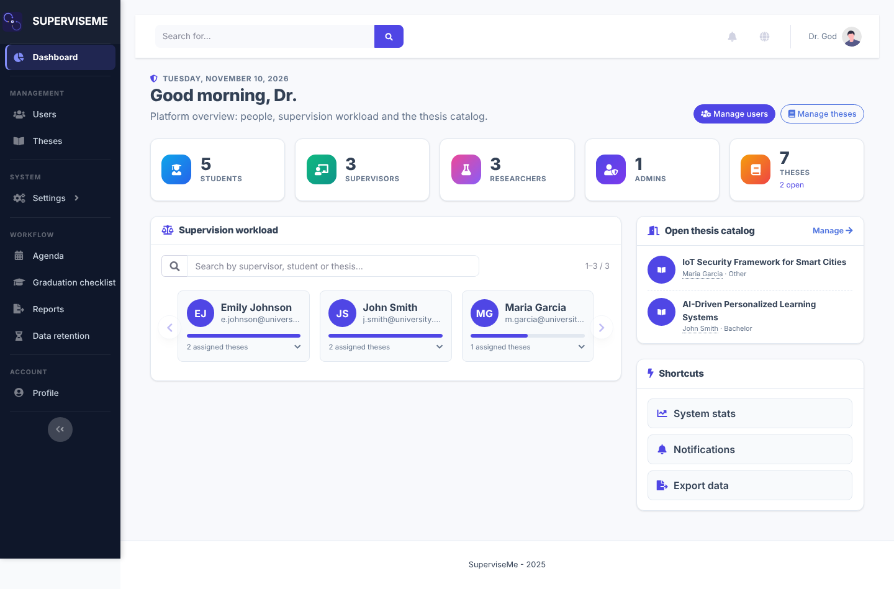
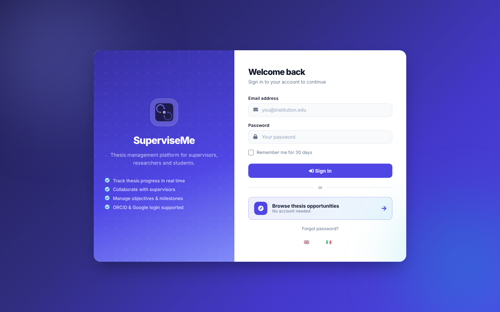
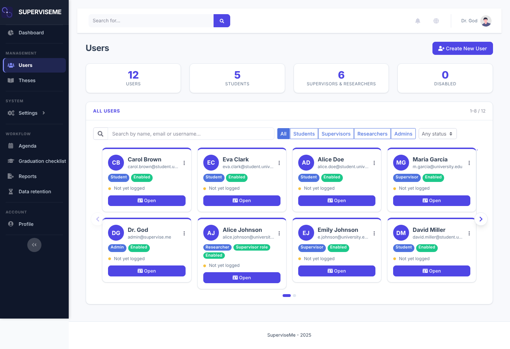
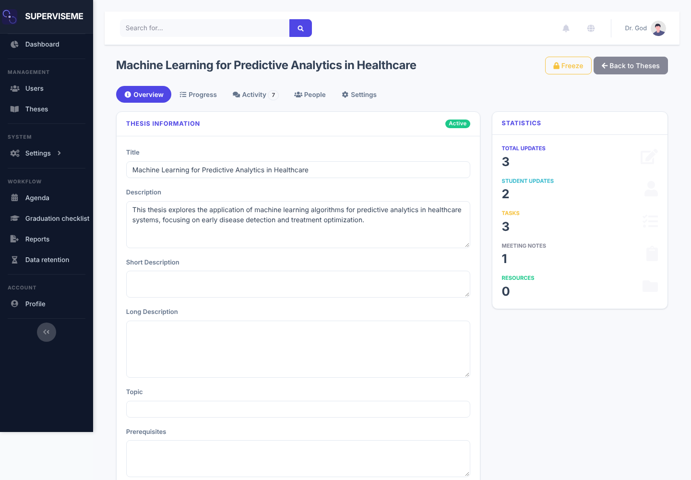
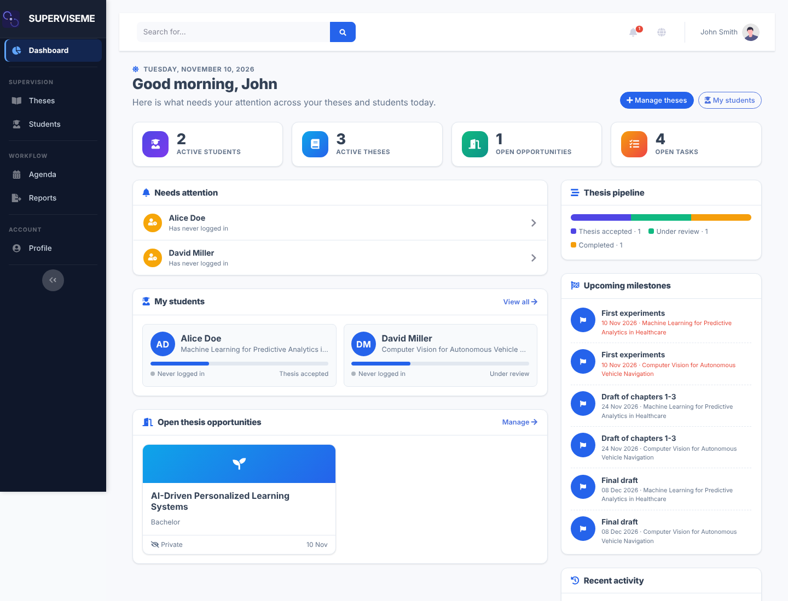
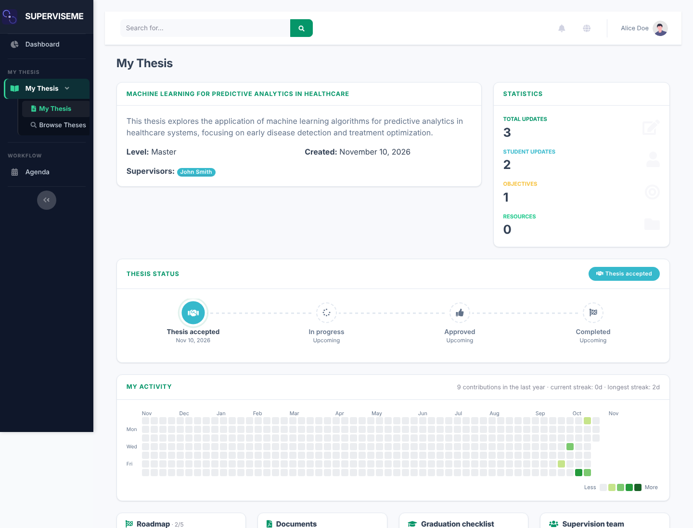
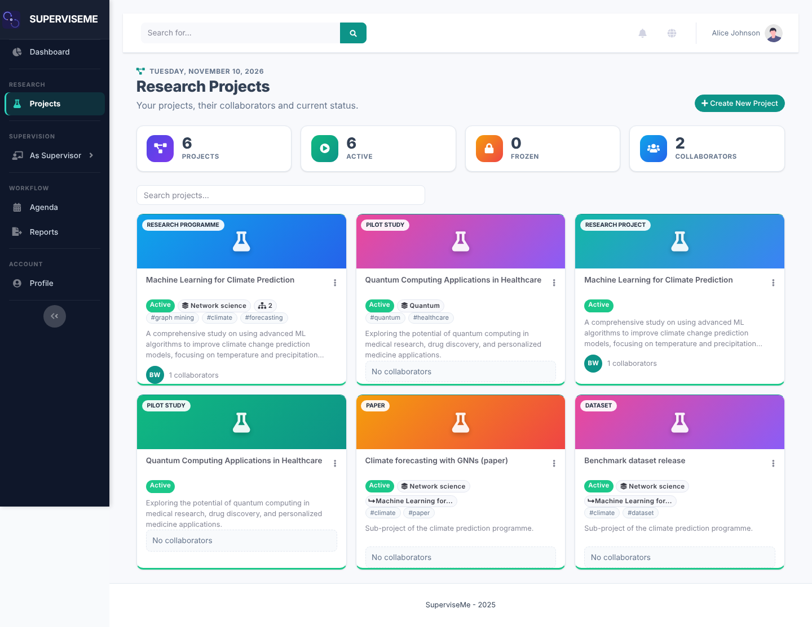
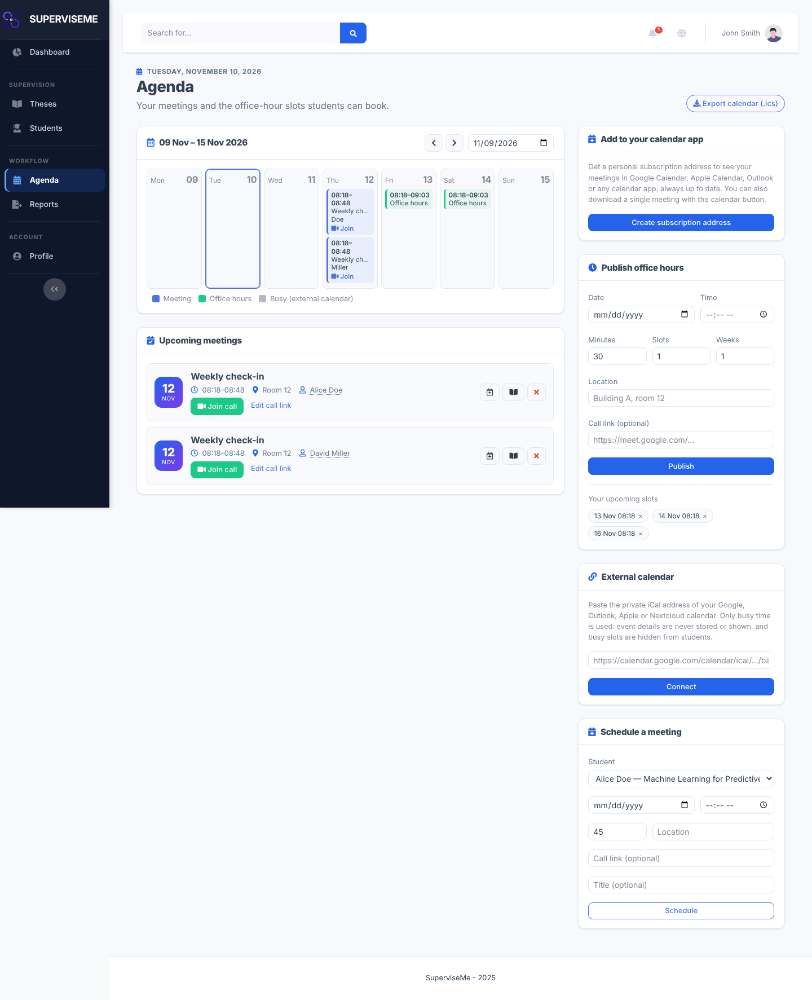

<p align="center">
  
</p>

<h1 align="center">SuperviseMe</h1>

<p align="center">
  Thesis supervision and research project management for academic environments.
</p>

<p align="center">
  📘 <a href="https://giuliorossetti.github.io/SuperviseMe/">Full documentation</a>
</p>

<p align="center">
  
</p>

SuperviseMe is a Flask web application that brings supervisors, students, researchers and administrators onto a single platform: thesis catalog and assignment, progress tracking, milestones, documents, meetings, graduation checklists, research projects, reports and notifications. Every role gets a dashboard and navigation tailored to its tasks, all built on a shared design language.

## ✨ Features

### Roles and access
- Email/password login (PBKDF2-SHA256), optional **ORCID** and **Google** sign-in ([docs](docs/social_login.md), [ORCID](docs/features/orcid.md)).
- Live search everywhere: lists filter as you type, the global search page refreshes dynamically and the top search box shows quick suggestions.
- Role-based access control for **admins**, **supervisors**, **researchers** and **students**. Researchers can be granted supervisor privileges and then see both areas.
- CSRF protection on all forms and AJAX calls, rate-limited and audited sensitive actions, Fernet-encrypted stored tokens.
- Profile pages with avatar, bio, ORCID, publications and **web links** (personal site, LinkedIn, …), with per-field privacy controls.

### Administrators
- Dashboard with platform statistics, **supervision workload** (searchable carousel, one supervisor expanded at a time) and the open thesis catalog.
- **Users** and **Theses** boards with search, filters and carousel pagination; per-user and per-thesis detail pages organised in tabs (Overview, Progress, Activity, People, Settings).
- **Research** area: platform overview (projects, funded, public pages, publications, datasets, overdue milestones, pending invitations and reviews, distribution by area/type), a filterable and paginated project catalog, a project page (team and invitation status, funding, output, milestones, reviews, public page) with admin actions (freeze, public page on/off, reassign owner, delete) and a **Publications** catalog with BibTeX export.
- Sidebar grouped by purpose: People, Supervision, Research, Planning, System, Account.
- Create/edit/disable users, grant supervisor role, reassign supervisors, freeze or delete theses, manage statuses.
- System statistics, notification/scheduler management, weekly-email preview, JSON/CSV export, data-retention tools (`RETENTION_MONTHS`).

### Supervisors
- Dashboard with "needs attention" alerts, student list, thesis pipeline, upcoming milestones, recent activity and shared to-dos.
- Thesis catalog management: publish open theses, handle students' **expressions of interest**, assign theses.
- Per-thesis workspace: updates and feedback, milestones, documents with versions and feedback, graduation checklist, meeting notes with action items, resources, BibTeX/reading lists.
- Capacity limits, inactivity alerts and weekly email reports.

### Students
- Personal thesis workspace: status timeline, activity heatmap, roadmap, documents, graduation checklist, supervision team, objectives, hypotheses, updates, meeting notes, to-dos and resources.
- Browse and express interest in open theses.

### Researchers
- **Research projects** with structured metadata: level (programme, project, pilot study, paper, dataset, …), thematic area, tags, images used as the project card cover, external links.
- **Sub-projects** and links between projects (for example several papers under one programme).
- Collaborators with roles (viewer is read-only) and **invitations with acceptance**; ownership transfer.
- **Research output** per project: publications (import by DOI from Crossref, BibTeX export), funding, milestones shown in the agenda and `.ics` feed, datasets with a FAIR checklist, linked theses, **internal review** of resources, import of works, funding and affiliations from ORCID, and **projects reusable as templates**.
- **Portfolio** statistics (by area, level, year, collaborators), optional **public project page** with owner-chosen fields, weekly researcher digest.
- A structured **project report** export, search and statistics.

### Cross-cutting
- **Agenda** with meetings, milestones and deadlines, plus an iCalendar (`.ics`) feed.
- **Reports** (PDF/CSV) and global search.
- **Notifications** by in-app alerts, email (weekly digests, reminders) and **Telegram** ([setup](docs/telegram_setup_detailed.md)).
- **Internationalisation** in English and Italian via Flask-Babel ([docs](docs/i18n.md)).
- Public thesis and profile pages, and a versioned REST API ([docs](docs/api.md)).
- Automatic **Alembic** schema upgrades at startup.

## 📸 Screenshots

Captured from the demo data produced by `scripts/seed_database.py`. Click a thumbnail for the full-size image.

<table>
<tr><td align="center" width="50%"><a href="docs/assets/images/login.png"></a><br><sub>Login</sub></td><td align="center" width="50%"><a href="docs/assets/images/admin-dashboard.png"></a><br><sub>Admin dashboard</sub></td></tr>
<tr><td align="center" width="50%"><a href="docs/assets/images/admin-users.png"></a><br><sub>Admin users</sub></td><td align="center" width="50%"><a href="docs/assets/images/admin-thesis.png"></a><br><sub>Admin thesis detail</sub></td></tr>
<tr><td align="center" width="50%"><a href="docs/assets/images/supervisor-dashboard.png"></a><br><sub>Supervisor dashboard</sub></td><td align="center" width="50%"><a href="docs/assets/images/student-thesis.png"></a><br><sub>Student thesis workspace</sub></td></tr>
<tr><td align="center" width="50%"><a href="docs/assets/images/researcher-projects.png"></a><br><sub>Research projects</sub></td><td align="center" width="50%"><a href="docs/assets/images/agenda.png"></a><br><sub>Agenda</sub></td></tr>
</table>

## 🚀 Installation

### Local development

Requirements: Python 3.10+ (3.12 recommended, as used by the Docker image) and pip. PostgreSQL is optional.

```bash
git clone https://github.com/GiulioRossetti/SuperviseMe.git
cd SuperviseMe
pip install -r requirements.txt

# Optional: choose seed passwords
export ADMIN_BOOTSTRAP_PASSWORD=change-me-admin
export SEED_DEFAULT_PASSWORD=change-me-seed
# or SEED_SUPERVISOR_PASSWORD / SEED_STUDENT_PASSWORD / SEED_RESEARCHER_PASSWORD

# Create the database with sample data
python scripts/seed_database.py

# Start the app
python superviseme.py
```

Open <http://localhost:8080>.

The schema is managed with **Alembic** (`migrations/`). Pending migrations are applied automatically at startup; to run them manually use `flask db upgrade` (or `make migrate`). The old `migrate_*.py` scripts now live in `scripts/legacy/` and are not needed on current versions.

Command line options:

```text
python superviseme.py --help
  -x, --host TEXT               Host address (default: localhost)
  -y, --port TEXT               Port (default: 8080)
  -d, --debug                   Enable debug mode
  -D, --db [sqlite|postgresql]  Database type (default: sqlite)
```

### Docker

```bash
cp .env.example .env     # set SECRET_KEY, ADMIN_BOOTSTRAP_PASSWORD, DB and mail settings
docker compose up -d
```

Compose files: `docker-compose.yml` (full stack with PostgreSQL, nginx and mail), `docker-compose.simple.yml` and `docker-compose.dev.yml`. See [docs/docker_deployment.md](docs/docker_deployment.md) and [docs/installation.md](docs/installation.md).

## ⚙️ Configuration

Configuration is read from environment variables (see `.env.example` and [docs/configuration.md](docs/configuration.md)).

| Variable | Purpose |
| --- | --- |
| `FLASK_ENV`, `DEBUG` | Environment and debug mode |
| `SECRET_KEY` | Flask secret key (required in production) |
| `TOKEN_ENCRYPTION_KEY` | Fernet key for stored tokens (required in production) |
| `ADMIN_BOOTSTRAP_PASSWORD` | Password of the bootstrap admin `admin@supervise.me` |
| `SEED_*_PASSWORD` | Passwords for seeded sample users |
| `PG_USER`, `PG_PASSWORD`, `PG_HOST`, `PG_PORT`, `PG_DBNAME` | PostgreSQL connection (SQLite is used otherwise) |
| `MAIL_*` | SMTP settings for notifications and weekly reports |
| `ORCID_CLIENT_ID`, `ORCID_CLIENT_SECRET`, `ORCID_SCOPE` | ORCID sign-in |
| `GOOGLE_CLIENT_ID`, `GOOGLE_CLIENT_SECRET` | Google sign-in |
| `TELEGRAM_BOT_TOKEN`, `TELEGRAM_BOT_USERNAME` | Telegram notifications |
| `BASE_URL` | Public URL used in emails and links |
| `COOKIE_SECURE` | Force the `Secure` flag on session cookies on/off (default: on in production) |
| `CSP_MODE`, `CSP_EXTRA_SOURCES`, `CSP_REPORT_URI` | Content-Security-Policy: `enforce` (default), `report-only` or `off`; extra allowed sources; optional report endpoint |
| `UPLOAD_FOLDER` | Where uploaded documents and images are stored |
| `RETENTION_ENABLED` | Set to `true` to enable the nightly data-retention deletion (default: off) |
| `RETENTION_MONTHS` | Data retention window (default 24) |
| `ENABLE_SCHEDULER` | Enable background jobs; set to `true` on exactly one worker |
| `SKIP_DB_SEED`, `USE_PROXY_FIX` | Skip sample data seeding; trust reverse-proxy headers |

### Security notes

- Login attempts are throttled (5 failures per account/IP and 30 per IP in 15 minutes by default; counters are per process, add an nginx `limit_req` or shared limiter when running many workers).
- New passwords need at least 8 characters with a letter and a digit; admin password resets need 12.
- Session cookies are `HttpOnly` and, in production, `Secure`; responses carry `X-Frame-Options`, `X-Content-Type-Options`, `Referrer-Policy` and (over HTTPS) HSTS.
- Research-project collaborators with the `viewer` role are read-only.

### Production notes

```bash
export FLASK_ENV=production
export SECRET_KEY=...
export TOKEN_ENCRYPTION_KEY=...
export ADMIN_BOOTSTRAP_PASSWORD=...
export SKIP_DB_SEED=true
gunicorn -w 4 -b 0.0.0.0:8000 wsgi:app
```

Run the scheduler (`ENABLE_SCHEDULER=true`) in a single service only and keep every web replica at `false`. The full checklist is in [docs/deployment_runbook_detailed.md](docs/deployment_runbook_detailed.md); see also [BACKUP_RESTORE_PROCEDURE.md](BACKUP_RESTORE_PROCEDURE.md).

## 👥 Sample data and credentials

`scripts/seed_database.py` creates 1 admin, 3 supervisors, 3 researchers (two with supervisor privileges), 5 students, 7 theses and 4 research projects (plus a sub-project). The research projects showcase the researcher features:

- **Climate programme** (Dr. Alice): funding (ERC), a sub-project, 2 publications, milestones (one overdue, one done), a dataset with full FAIR checklist, a linked thesis, two review requests to Dr. Bob (one pending, one approved), a **pending invitation** for Dr. Maria and a public page. Log in as Dr. Bob to answer the review, as Dr. Maria to accept the invitation.
- **Social network project** (Dr. Bob): PRIN funding, publications, a dataset, public page with a reduced set of fields.
- **Ethics project** (Dr. Maria): Dr. Bob is a read-only **viewer**.
- Dr. Alice has an **ORCID record** (works, funding, employment) so the "Import from your ORCID record" and funding import can be tried; the employment appears as affiliation in the project team.
- Open *Portfolio*, *Publications* and the *Agenda* (project milestones) as Dr. Alice; the public pages are at `/projects/<id>` (no login).

Re-running the script resets the demo data. Passwords come from the environment (role-specific `SEED_*_PASSWORD`, then `SEED_DEFAULT_PASSWORD`; development fallback `test`).

| Role | Accounts |
| --- | --- |
| Admin | `admin@supervise.me` (`ADMIN_BOOTSTRAP_PASSWORD`) |
| Supervisors | `j.smith@university.edu`, `e.johnson@university.edu`, `m.garcia@university.edu` |
| Researchers | `alice.johnson@university.edu` (also supervisor), `bob.williams@university.edu`, `maria.rodriguez@university.edu` (also supervisor) |
| Students | `alice.doe@`, `bob.wilson@`, `carol.brown@`, `david.miller@`, `eva.clark@` `student.university.edu` |

## 🧪 Development

```bash
pip install -r requirements-dev.txt   # test and lint tools
pip install -r requirements.lock      # alternative: exact, reproducible runtime versions
make ci       # lint + compile + schema alignment + migrations + tests
make test     # pytest
make smoke    # smoke checks against a local server
```

CI (GitHub Actions) runs `ruff`, compile checks, schema alignment (`scripts/check_schema_alignment.py`), migrations and `pytest`. Documentation is built with MkDocs (`mkdocs.yml`) and deployed to GitHub Pages.

Translations: extract/update with Babel, then `pybabel compile -d superviseme/translations`.

When you change the database: update `superviseme/models.py`, add an Alembic migration in `migrations/versions/`, and keep `data_schema/` aligned (`make schema`).

## 📁 Project structure

```text
SuperviseMe/
├── superviseme/
│   ├── __init__.py          # Application factory, config, startup upgrade
│   ├── models.py            # SQLAlchemy models
│   ├── routes/              # auth, admin (+_theses, _research, _system), supervisor (+_theses, _workspace), student, researcher (+_projects, _output),
│   │                        # profile, public, media, workflow, notifications, api_v1
│   ├── services/            # Service layer
│   ├── utils/               # Domain helpers: projects, checklist, documents,
│   │                        # meetings, reports, search, privacy, ics, orcid_client,
│   │                        # telegram_service, email_service, task_scheduler, ...
│   ├── templates/           # Jinja2 templates (admin/, supervisor/, student/,
│   │                        # researcher/, components/, public/)
│   ├── static/              # CSS (superviseme.css), JS (sm-carousel.js), images
│   └── translations/        # EN / IT catalogs
├── migrations/              # Alembic migrations
├── data_schema/             # Reference schema
├── scripts/                 # seed_database.py, check_schema_alignment.py, smoke tests
├── tests/                   # pytest suite
├── docs/                    # MkDocs documentation and README assets
├── nginx/, Dockerfile, docker-compose*.yml
├── Makefile
├── superviseme.py           # Development entry point
└── wsgi.py                  # WSGI entry point
```

## 🤝 Contributing

1. Fork the repository
2. Create a feature branch (`git checkout -b feature/amazing-feature`)
3. Commit your changes and make sure `make ci` passes
4. Push the branch and open a Pull Request

## 📄 License

GNU General Public License v3.0 — see [LICENSE](LICENSE).

## 🙋 Support

Open an issue on GitHub or consult the [documentation](https://giuliorossetti.github.io/SuperviseMe/).
