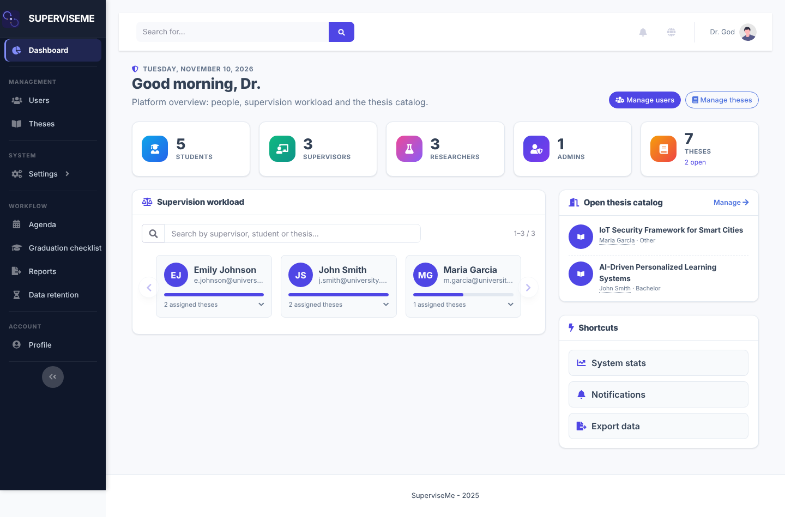

# Administration

Admins manage people, theses, research and system settings from a sidebar grouped into People, Supervision, Research, Planning, System and Account.

## Users, theses and research

Searchable boards with filters, per-user and per-thesis detail pages, role changes, supervisor reassignment, and freezing or deleting theses. The Research area gives a platform overview and a project catalog. Publications, datasets and software can be associated with platform users and their projects or theses, and searched by any of them.

## Supervisor capacity

Each supervisor can have a personal limit on active students. Supervisors without one inherit the default.

| Variable | Purpose |
| --- | --- |
| `DEFAULT_MAX_STUDENTS` | Default limit (empty = unlimited) |
| `CAPACITY_WARN_RATIO` | Fraction of the limit that triggers a warning |

## Reminders

Daily reminders cover overdue project milestones, projects without activity, public outputs missing a DOI, and supervisors close to or at their limit.

## Statistics

The Statistics page shows outputs per year, area and project, theses by status, supervision load and monthly activity, with CSV export.

## Duplicates

The Possible duplicates page finds outputs sharing a DOI or with the same or similar title, and offers a guided merge.

## Activity trail

A persistent trail records who created, edited, moved, associated or deleted outputs.

## Backup and restore

Backups are portable zip files (data plus uploads) tied to the database schema revision. From **Admin → Backup** you can create, download and delete backups. Restoring requires typing `RESTORE`, takes a safety backup first, and logs you out afterwards.

| Variable | Purpose |
| --- | --- |
| `BACKUP_DIR` | Backup folder (default `superviseme/db/backups`) |
| `BACKUP_AUTO` | `true` enables the nightly backup at 02:30 |
| `BACKUP_KEEP` | Number of automatic backups kept |

!!! tip
    Run the scheduler (`ENABLE_SCHEDULER=true`) in a single service only.

## Data retention

Set `RETENTION_ENABLED=true` to enable nightly deletion beyond `RETENTION_MONTHS` (default 24). It is off by default.
