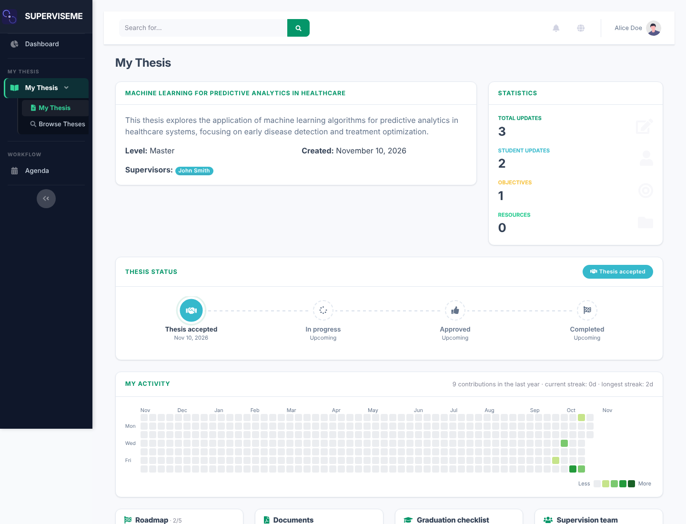
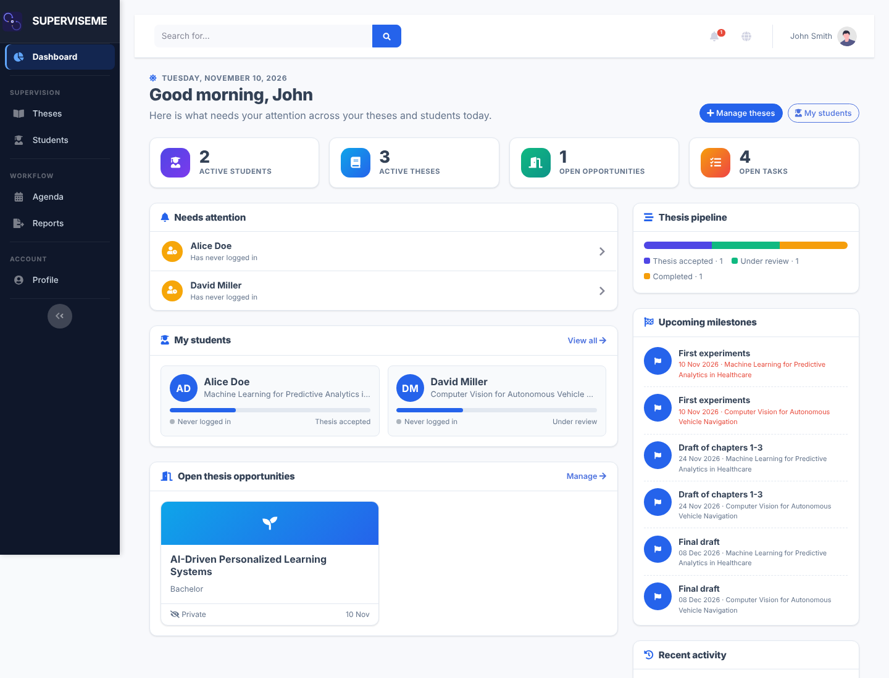
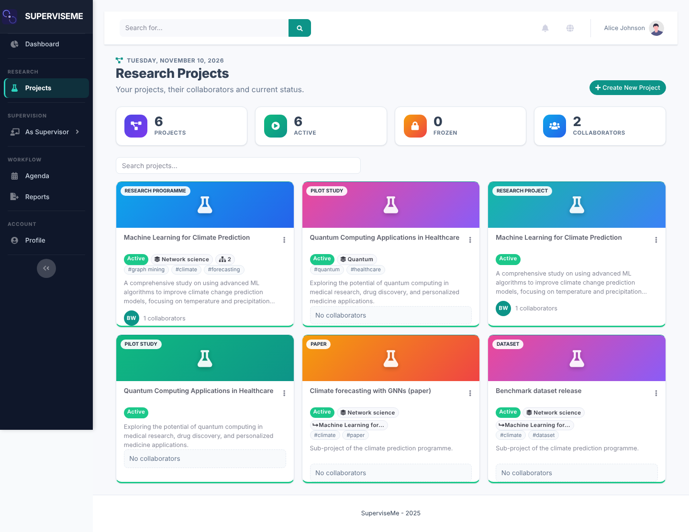

# Roles & workflows

SuperviseMe has four roles. Researchers can be granted supervisor privileges and then see both areas.

## Students

A personal thesis workspace: status timeline, activity heatmap, roadmap, documents, graduation checklist, supervision team, objectives, hypotheses, updates, meeting notes, to-dos and resources. Students can also browse open theses and express interest.

## Supervisors

- Dashboard with "needs attention" alerts, student list, thesis pipeline, upcoming milestones and recent activity.
- Thesis catalog: publish open theses, handle expressions of interest, assign theses.
- Per-thesis workspace: feedback, milestones, versioned documents, graduation checklist, meeting notes with action items, reading lists.
- Capacity limits, inactivity alerts and weekly email reports.

## Researchers

- Research projects with level, thematic area, tags, cover image and external links; sub-projects and links between projects.
- Collaborators with roles and invitations; ownership transfer.
- Outputs per project: publications (DOI import from Crossref, BibTeX), datasets with a FAIR checklist, software (repository, version, DOI, license), funding and milestones.
- Edit outputs at any time and assign works imported from [ORCID](features/orcid.md) to several projects at once.
- Portfolio statistics and optional public project pages with BibTeX, CodeMeta and `CITATION.cff` exports.

## Cross-cutting

- Agenda with meetings, milestones and deadlines, plus an iCalendar feed.
- Reports (PDF/CSV) for theses and research projects, and global search.
- Notifications by in-app alerts, email and Telegram; English and Italian interface.
- Versioned [REST API](api.md).
